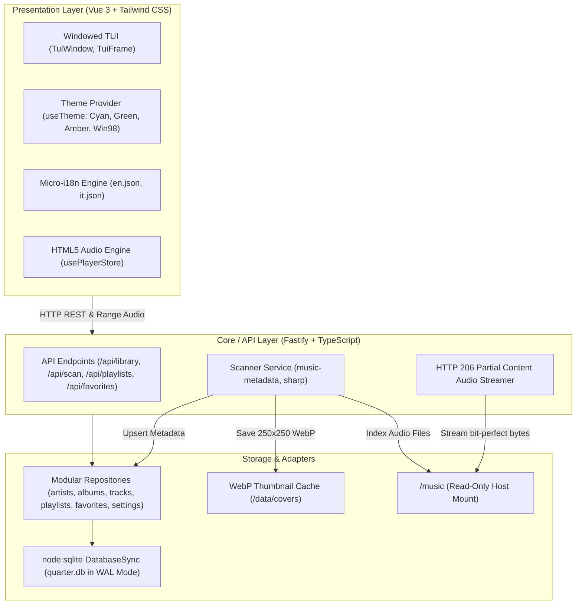

# Architecture & Modularity: Quarter Note ♩

> **Quarter Note** is a minimal, blazing-fast, self-hosted music streamer designed for local home networks (ZimaBlade, CasaOS, Docker) featuring an authentic retro BBS / curses TUI aesthetic.
> This document adheres to the [Self-Hosting Digital Independence Manifesto](file:///C:/Users/costa/.agents/MANIFESTO.md) and [Agent Rules](file:///C:/Users/costa/.agents/rules/digital-independence.md).

---

## 1. High-Level Architecture & Component Interaction



---

## 2. Decoupled Layering

1. **Presentation (Client - `client/src/`)**:
   - Purely declarative components wrapped in `<TuiWindow>` frames.
   - **Theme-Decoupled**: Zero hardcoded hex colors; styling is driven by CSS semantic theme tokens (`var(--theme-bg)`, `var(--theme-accent)`, `var(--theme-border)`).
   - **i18n-Ready**: Zero hardcoded text in components; all user-facing strings are resolved via `t('key')` from `locales/en.json` and `locales/it.json`.
   - **Compact Modules**: View and sub-components are kept under 250 lines (e.g. `FavoriteContainerBox.vue`, `FavoriteTrackRow.vue`, `FavoriteMediaCard.vue`).

2. **Core / API (`server/src/routes/` & `server/src/scanner/`)**:
   - Manages asynchronous library scanning, HTTP 206 Partial Content Range streaming, and Fastify route plugins.
   - Zero background polling daemons or cloud network calls.

3. **Storage & Persistence (`server/src/db/`)**:
   - Storage queries are modularized into domain-specific repositories (`repositories/artists.ts`, `albums.ts`, `tracks.ts`, `playlists.ts`, `favorites.ts`, `settings.ts`).
   - Relies on Node 24 native `node:sqlite` (`DatabaseSync` in WAL mode) for zero C++ native dependency bloat and instant startup.

---

## 3. Formal Extension Points

Quarter Note is designed with clear extension points to allow adding new capabilities without refactoring the core:

### Extension Point 1: Adding a New Retro UI Theme
1. Open `client/src/assets/main.css` and declare a new theme block:
   ```css
   [data-theme="cga"] {
     --theme-bg: #000000;
     --theme-panel: #000055;
     --theme-border: #ff55ff;
     --theme-accent: #55ffff;
     --theme-text: #ffffff;
     --theme-highlight: #ffff55;
     ...
   }
   ```
2. Register the theme in `client/src/composables/useTheme.ts`:
   ```typescript
   export const availableThemes: ThemeOption[] = [
     ...,
     { id: 'cga', name: 'CGA 4-Color (Cyan/Magenta)', tag: 'CGA' }
   ];
   ```

### Extension Point 2: Adding a New Language / Translation
1. Create a new dictionary file `client/src/i18n/locales/<lang>.json` copying the keys from `en.json`.
2. Register the locale in `client/src/i18n/index.ts`:
   ```typescript
   import es from './locales/es.json';
   export type Locale = 'en' | 'it' | 'es';
   availableLocales.push({ id: 'es', name: 'Español' });
   ```

### Extension Point 3: Adding a New Storage Repository Module
1. Create a dedicated repository in `server/src/db/repositories/<domain>.ts`.
2. Re-export the module in `server/src/db/repository.ts`.
3. Add in-memory tests in `server/src/db/repositories/<domain>.test.ts` using Node's built-in `node:test` and `node:sqlite`.

### Extension Point 4: Adding a New Audio Format / Codec
1. Update `SUPPORTED_AUDIO_EXTENSIONS` in `server/src/scanner/scanner.ts`.
2. Ensure `stream.ts` maps the appropriate MIME type for the extension.

### Extension Point 5: Adding a New TUI Screen
1. Create `client/src/views/<Feature>View.vue` wrapped in `<TuiWindow title="..." hotkey="F7">`.
2. Register the route in `client/src/router/index.ts`.
3. Add the hotkey handler in `client/src/App.vue`.

---

## 4. Testing & Verification

Run the test suite using Node 24's native test runner (zero external testing dependencies):

```bash
npm test
```

Build all packages:
```bash
npm run build
```
