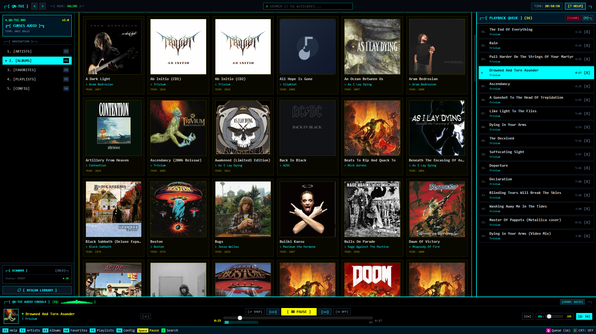

# Quarter Note ♩

**Quarter Note** is a minimal, blazing-fast, and responsive self-hosted music streamer for your local music library, designed specifically to run on **ZimaBlade** (and any Docker-capable host), featuring an authentic **retro BBS / curses TUI (Terminal User Interface)** aesthetic.



---

## AI Advisory

I built this project purely off of _vibes_. It probably contains a few bugs and features that can be easily be improved upon. The aim of this project wasn't to exercise my programming skills or learn new ones, it was to get a usable application as soon as possible for my self-hosting needs.

## Key Features

- ⚡ **Zero Bloat & Extreme Performance**: Built with TypeScript using **Fastify**, **Vue 3**, and Node 24's native **`node:sqlite`** module. Instant startup and minimal RAM footprint (~30-50 MB).
- 🖥️ **Retro BBS / Curses TUI Interface**: Windowed terminal frames, ASCII headers, function key navigation (`F1`-`F6`, `Space`, `/`, `Q`, `C`, `ESC`), cassette player ASCII art, animated VU/spectrum meter, and optional CRT scanlines.
- 🎚️ **Integrated Playback Rate Controller**: Native playback speed adjustments (`0.5x`, `0.75x`, `0.85x`, `1.0x`, `1.15x`, `1.25x`, `1.5x`, `2.0x`) for music practice, transcription, or quick listening.
- 🎵 **Bit-Perfect Quality & Instant Seek**: HTTP audio streaming with complete `Range` header support (`206 Partial Content`).
- 🖼️ **Fast WebP Cover Art**: Automatic extraction from embedded audio tags or directory files (`cover.jpg`, `folder.png`), with cached 250x250 thumbnails powered by **Sharp**.
- 📑 **Playlists & Playback Queue**: Create and manage custom playlists, add tracks to queue, and reorder them on the fly using the slide-over queue drawer.
- ⭐ **Favorites with Drag & Drop**: Categorize your favorite artists, albums, tracks, and playlists into custom categories using drag-and-drop.
- 🔍 **Real-Time Instant Search**: Live search results grouped by Artists, Albums, and Tracks as you type.
- 🚀 **Zero Login**: Seamless instant access on your local network with no login gates or passwords to remember.

---

## Quick Start with Docker & CasaOS (ZimaBlade)

The easiest way to deploy Quarter Note on ZimaBlade (or any Linux server running Docker / CasaOS) is via Docker Compose:

1. Clone the repository or copy the project folder to your server:
   ```sh
   git clone https://github.com/Costa92/Quarter_Note.git
   cd Quarter_Note
   ```
2. Update the music directory mount in `docker-compose.yml` to point to your media drive:
   ```yaml
   volumes:
     - /media/my-drive/Music:/music:ro
     - ./data:/data
   ```
   *(Note: On CasaOS, you can also easily configure this directory via the CasaOS App Settings Web GUI).*
3. Start the container:
   ```sh
   docker compose up -d --build
   ```
4. Open your browser at `http://<ZIMABLADE-IP>:8080` (or click the Quarter Note app icon directly from your CasaOS dashboard).
5. Click **"[ RESCAN LIBRARY ]"** in the sidebar to start indexing your music collection.

---

## Global Keyboard Shortcuts (TUI)

| Key | Action |
| --- | --- |
| `F1` or `?` | Open Help & Keybindings Modal |
| `F2` or `1` | Artists Directory |
| `F3` or `2` | Albums Catalog |
| `F4` or `3` | Favorites Archive |
| `F5` or `4` | Playlists Archive |
| `F6` or `5` | System Configuration |
| `Space` | Play / Pause audio |
| `N` / `P` | Next / Previous track |
| `/` | Focus search prompt |
| `Q` | Toggle Playback Queue Drawer |
| `C` | Toggle CRT Scanline Shader Effect |
| `ESC` | Close modal dialogs / Cancel |

---

## Local Development

Requirements: **Node.js >= 22.5.0** (Node 24 recommended)

```sh
# 1. Install all monorepo dependencies
npm install

# 2. Build shared, client, and server packages
npm run build

# 3. Start development servers
# In one terminal, launch the Fastify backend:
npm run dev:server

# In another terminal, launch the Vite client:
npm run dev:client
```

The development client will be available at `http://localhost:5173` with an automatic proxy to the API server at port `8080`.

---

## Documentation

- [Scope & Requirements](file:///docs/scope.md)
- [Technical Architecture](file:///docs/architecture.md)
- [Implementation Roadmap](file:///docs/development.md)
- [LLM & AI Developer Guide](file:///AGENTS.md)
- [LLM Recipes & Extension Guide](file:///docs/llm-developer-guide.md)
