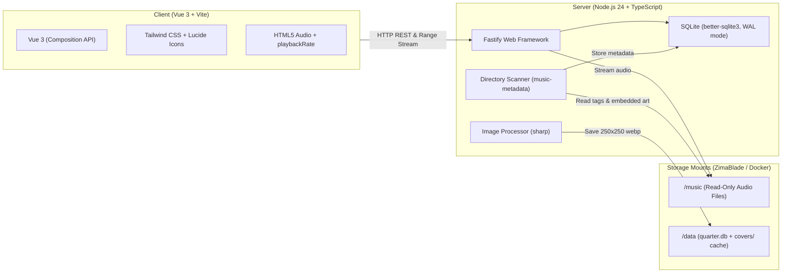
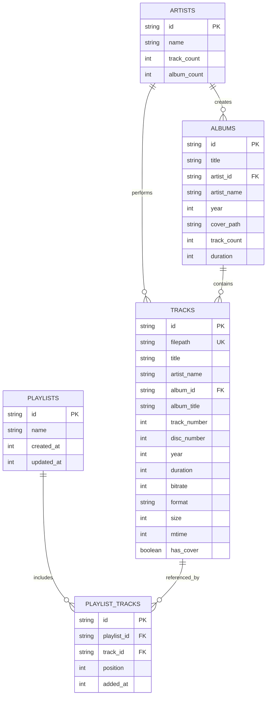
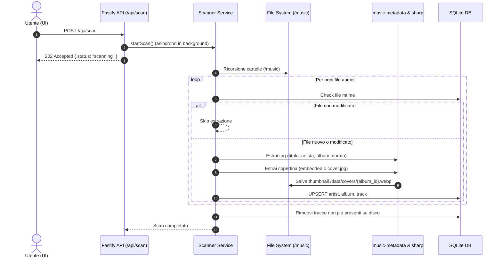
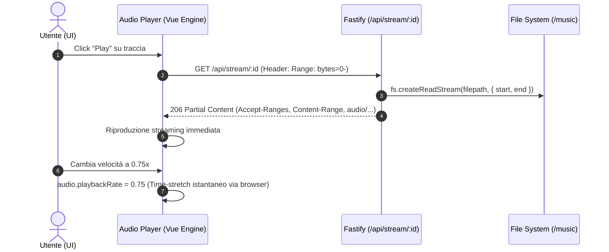

# Quarter Note ♩ - Technical Architecture

Questo documento descrive l'architettura tecnica, i contratti dati e i componenti del progetto **Quarter note**.

---

## 1. Tecnologie e Dipendenze



- **Runtime**: Node.js 24 (LTS)
- **Backend**:
  - `fastify`: Server HTTP ad altissime prestazioni e basso overhead di memoria.
  - `@fastify/static`: Servizio file statici (frontend compilato e copertine).
  - `@fastify/cors`: CORS per sviluppo locale.
  - `better-sqlite3`: Driver SQLite sincrono nativo C++, il più veloce in ambiente Node.
  - `music-metadata`: Estrazione metadati (ID3v1, ID3v2, FLAC, Vorbis, MP4/AAC, Opus, Ogg, WAV) e copertine embedded.
  - `sharp`: Generazione thumbnail WebP (250x250) ad alta velocità con libvips.
- **Frontend**:
  - `vue`: Vue 3 con `<script setup lang="ts">`.
  - `vue-router`: Routing client-side SPA.
  - `vite`: Build tool fulmineo.
  - `tailwindcss`: Design scuro, compatto, ad alta densità informativa.
  - `lucide-vue-next`: Icone vettoriali pulite e leggere.
- **Shared**:
  - Interfacce TypeScript condivise (`Track`, `Album`, `Artist`, `Playlist`, `ScanStatus`).

---

## 2. Schema Database SQLite (`/data/quarter.db`)



---

## 3. Flusso Dati e Componenti

### A. Scansione Libreria (Scanner Flow)


### B. Streaming Audio con Controllo Velocità (Playback Flow)


---

## 4. Architettura Frontend (Vue 3)

### Albero Componenti
```text
App.vue
├── Sidebar.vue            # Logo "Quarter Note", Navigazione (Artisti, Album, Brani, Playlist), Tasto Scan
├── Header.vue             # Barra di ricerca rapida, breadcrumb di navigazione
├── RouterView             # Viste dense e compatte
│   ├── ArtistsView.vue    # Griglia/lista compatta artisti
│   ├── ArtistDetail.vue   # Album e brani dell'artista selezionato
│   ├── AlbumsView.vue     # Griglia copertine + titoli (250x250)
│   ├── AlbumDetail.vue    # Dettaglio album con tabella brani (colonne: #, Titolo, Durata, Azioni)
│   ├── TracksView.vue     # Lista complessiva brani con ordinamento veloce
│   ├── PlaylistsView.vue  # Gestione playlist
│   └── PlaylistDetail.vue # Brani in playlist con riordino e rimozione
├── Player.vue             # Barra player fissa in basso
│   ├── TrackInfo.vue      # Copertina miniatura, Titolo, Artista (link rapidi)
│   ├── PlaybackControls   # Prev, Play/Pause, Next, Shuffle, Repeat
│   ├── ProgressBar.vue    # Scrubber temporale continuo con drag
│   ├── SpeedSelector.vue  # Selettore velocità (0.5x, 0.75x, 1x, 1.25x, 1.5x, 2x)
│   ├── VolumeControl.vue  # Slider volume + Mute
│   └── QueueToggle.vue    # Pulsante per aprire il pannello Coda
└── QueueDrawer.vue        # Pannello a comparsa laterale: brani in coda, riordino, pulisci coda
```

### State Management (`usePlayerStore`)
Un composable o store centralizzato per il ciclo audio:
- `currentTrack: Track | null`
- `isPlaying: boolean`
- `currentTime: number`
- `duration: number`
- `playbackRate: number` (default `1.0`)
- `volume: number` (default `1.0`, persistito in localStorage)
- `queue: Track[]`
- `queueIndex: number`
- `shuffle: boolean`
- `repeatMode: 'off' | 'all' | 'one'`

---

## 5. Deployment Docker (ZimaBlade)

### Dockerfile Multi-Stage
1. **Stage `builder-client`** (`node:24-alpine`): compila il frontend Vue con Vite (`npm run build` ➔ `/client/dist`).
2. **Stage `builder-server`** (`node:24-alpine`): compila TypeScript del server (`npm run build` ➔ `/server/dist`).
3. **Stage `runner`** (`node:24-alpine`): installa solo le dipendenze di produzione (con compilazione nativa per `better-sqlite3` e `sharp`), copia i file compilati, espone la porta `8080`, definisce volumi `/music` (ro) e `/data`.

### File `docker-compose.yml`
```yaml
services:
  quarter-note:
    build: .
    container_name: quarter-note
    restart: unless-stopped
    ports:
      - "8080:8080"
    environment:
      - PORT=8080
      - MUSIC_DIR=/music
      - DATA_DIR=/data
    volumes:
      - /path/to/my/music:/music:ro
      - /path/to/app/data:/data
```
