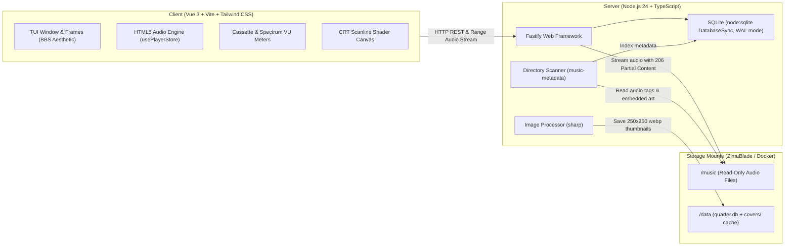
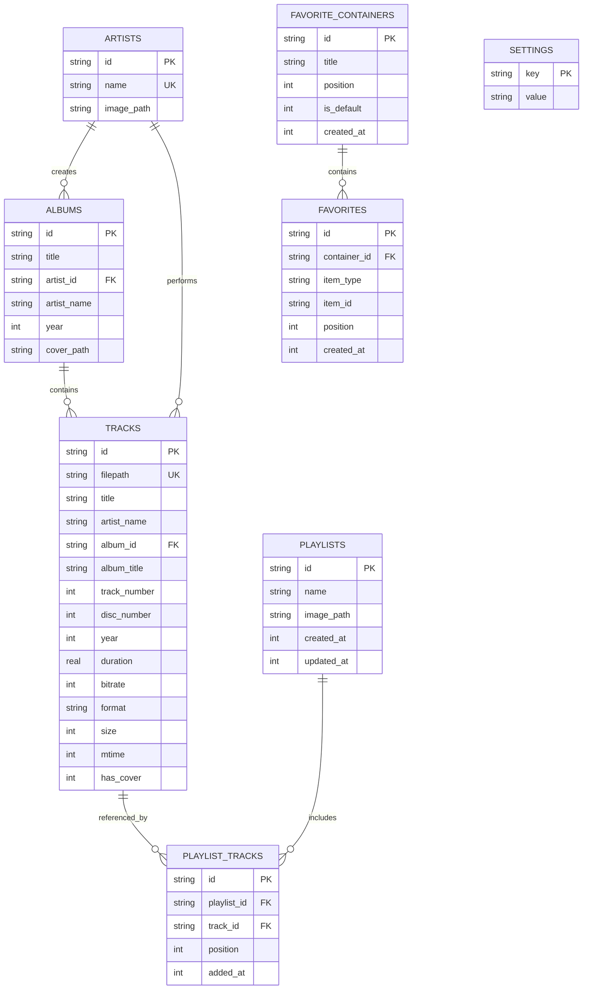
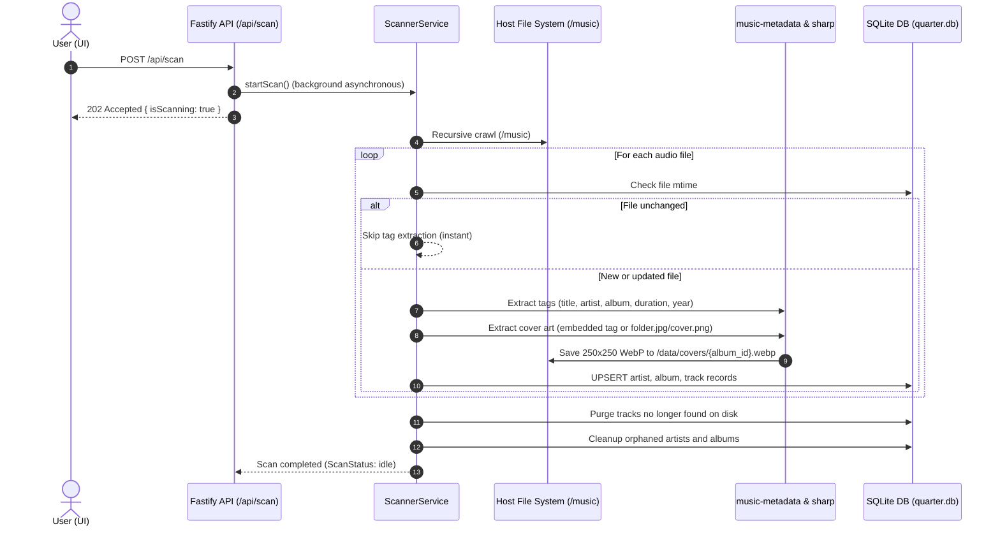
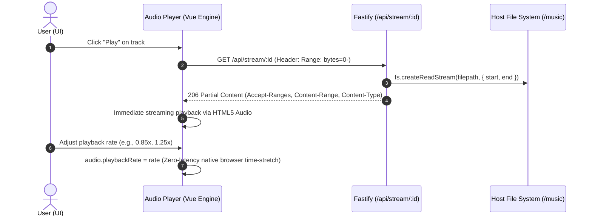

# Quarter Note ♩ - Technical Architecture

This document describes the technical architecture, data contracts, and component design of **Quarter Note**, a minimal, blazing-fast, self-hosted music streamer designed for ZimaBlade and Docker environments with an authentic retro BBS / curses TUI aesthetic.

---

## 1. System Overview & Technology Stack



### Core Technologies
- **Runtime**: **Node.js 24 (LTS)** with native ES modules and TypeScript.
- **Backend**:
  - `fastify`: High-throughput, low-latency web framework with minimal memory footprint (~30-50 MB).
  - `@fastify/static`: Serves compiled client SPA and cached album art.
  - `@fastify/cors`: CORS middleware for local development.
  - `node:sqlite`: Node 24's built-in synchronous `DatabaseSync` engine in WAL mode (zero external C++ binary compilation issues).
  - `music-metadata`: Extraction of metadata (ID3v1, ID3v2, FLAC, Vorbis, MP4/AAC, Opus, Ogg, WAV) and embedded cover art.
  - `sharp`: Ultra-fast thumbnail generation (250x250 WebP) powered by libvips.
- **Frontend**:
  - `vue`: Vue 3 with Composition API (`<script setup lang="ts">`).
  - `vue-router`: Single-Page Application client-side routing.
  - `vite`: Fast compilation and Hot Module Replacement (HMR).
  - `tailwindcss`: High-density terminal user interface styling, monospace typography, scanlines, and retro palettes.
  - `lucide-vue-next`: Clean vector icons.
- **Shared (`@quarter-note/shared`)**:
  - Centralized TypeScript interfaces (`Track`, `Album`, `Artist`, `Playlist`, `FavoriteContainer`, `ScanStatus`, `AppSettings`).

---

## 2. Database Schema (`/data/quarter.db`)

Quarter Note uses an embedded SQLite database managed with `node:sqlite`. SQLite runs in **WAL (Write-Ahead Logging)** mode with normal synchronous writes and foreign keys enabled for maximum concurrency and data integrity.



### Schema Indices
- `idx_tracks_album_id` ON `tracks(album_id)`
- `idx_tracks_artist_name` ON `tracks(artist_name)`
- `idx_tracks_title` ON `tracks(title)`
- `idx_albums_artist_id` ON `albums(artist_id)`
- `idx_playlist_tracks_playlist_id` ON `playlist_tracks(playlist_id, position)`
- `idx_favorites_container_id` ON `favorites(container_id, position)`
- `idx_favorites_item` ON `favorites(item_type, item_id)`

---

## 3. Data Flows & Services

### A. Library Scanner Flow
The scanner traverses the mounted music folder (`/music`), extracts metadata, generates WebP thumbnails, and purges removed tracks:



### B. Bit-Perfect Audio Streaming Flow
Audio playback uses native HTTP `Range` requests (`206 Partial Content`). Audio is piped directly from disk without lossy transcoding:



---

## 4. Frontend Architecture (Vue 3 + TUI BBS Theme)

### Component Hierarchy
```text
App.vue (Global key listener: F1-F6, Space, N/P, /, Q, C, ESC)
├── CrtScanlines.vue       # Retro CRT phosphor scanline shader overlay (toggleable with 'C')
├── TuiHeader.vue          # ASCII banner, system date/time, and instant search box ('/')
├── Navigation (F2-F6)
│   ├── ArtistsView.vue    # F2: ASCII frame, artist photos, album counter
│   │   └── ArtistDetail   # Discography and track list
│   ├── AlbumsView.vue     # F3: ASCII catalog, 250x250 WebP album art
│   │   └── AlbumDetail    # Tracklist table with track number, title, duration, actions
│   ├── FavoritesView.vue  # F4: Custom divider containers with HTML5 drag-and-drop
│   ├── PlaylistsView.vue  # F5: Custom playlists, artwork uploads, creation modal
│   │   └── PlaylistDetail # Track reordering, duration summation, bulk play
│   └── SettingsView.vue   # F6: Music directory path, default startup view selector
├── CassettePlayer.vue     # Bottom player dock: cassette tape reels, ASCII VU meters
├── SpectrumMeter.vue      # Animated 8-bar retro frequency visualizer
├── QueueDrawer.vue        # Slide-over queue drawer ('Q') with track reordering
└── HelpModal.vue          # Function keys guide and ASCII help prompt ('F1' or '?')
```

### State Management (`usePlayerStore`)
Centralized reactive store controlling the audio lifecycle:
- `currentTrack: Track | null`
- `isPlaying: boolean`
- `currentTime: number`
- `duration: number`
- `playbackRate: number` (options: `0.5x`, `0.75x`, `0.85x`, `1.0x`, `1.15x`, `1.25x`, `1.5x`, `2.0x`)
- `volume: number` (0.0 to 1.0, persisted in `localStorage`)
- `queue: Track[]`
- `queueIndex: number`
- `shuffle: boolean`
- `repeatMode: 'off' | 'all' | 'one'`

---

## 5. Docker & CasaOS Architecture

Quarter Note runs as a lightweight, single-container service on ZimaBlade (or any Docker/Linux host).

### Filesystem Mounts
- `/music` (read-only): Host directory containing user audio files.
- `/data` (read-write): Host directory storing `quarter.db` (SQLite) and cached WebP thumbnails in `/data/covers/`, `/data/artists/`, `/data/playlists/`.

### CasaOS Integration (`x-casaos`)
The [docker-compose.yml](file:///C:/Users/costa/Home/Opus/Quarter_Note/docker-compose.yml) includes first-class CasaOS metadata:
- Service image tag: `image: quarter-note:latest` ensures CasaOS Settings UI allows editing volumes and ports.
- Web UI mapping: `port_map: "8080"`, `scheme: http`, `index: /`, `main: quarter-note` enables direct one-click launch from the CasaOS dashboard without "App may not be available" warnings.
- Container healthcheck: Native Node.js `fetch('http://127.0.0.1:8080/api/health')` probe every 30 seconds.
